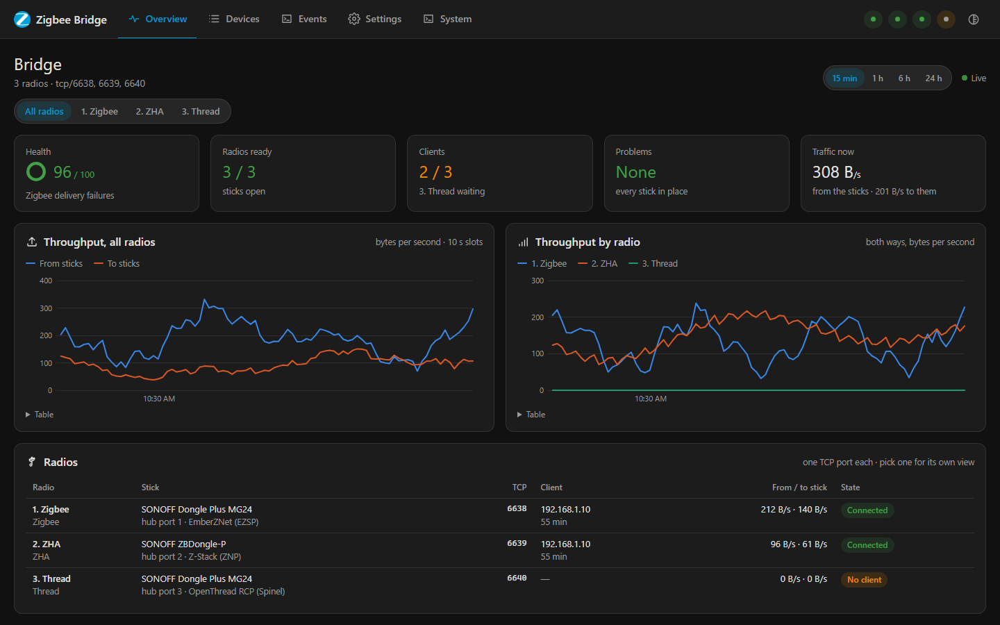
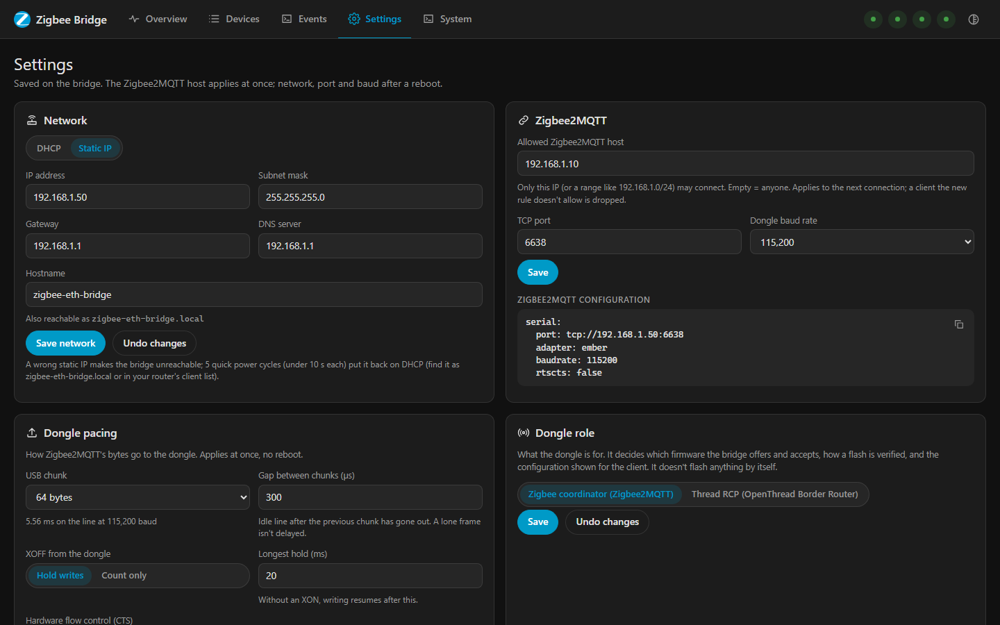

# Stick Bridge

**Put your USB radio sticks on the network, wherever reception is best.**

> Formerly **Zigbee Bridge** (`home-controls/zigbee-bridge`). Renamed because it bridges any radio
> stick that talks over serial, not only Zigbee. Old links redirect here and bridges already in use
> keep finding their updates; [docs/COMPATIBILITY.md](docs/COMPATIBILITY.md) lists the names that stay
> the same on purpose.

Your Zigbee, Thread or Z-Wave USB stick usually has to sit right next to the Home Assistant box, often
in a closet or behind a rack: not a great place for a radio. Stick Bridge is firmware for a small
Ethernet board that the stick plugs into instead. Run one network cable (with power over it, if your switch does
PoE) to a central spot, and Zigbee2MQTT talks to the stick over the network as if it were still
plugged in.

Add a powered USB hub and one bridge carries **up to four radios**, each on its own network port:
Zigbee2MQTT, Home Assistant's ZHA, an OpenThread Border Router and Z-Wave JS can all sit in one good
spot. Plug a stick in and it sets itself up.

It also keeps an eye on the links: a dashboard shows how each app and its stick are getting on,
which devices it hears and how well, and warns you about trouble.



## What it does

- **Bridges your stick to Zigbee2MQTT** over TCP, with nothing to install on the Home Assistant side.
- **Up to four radios behind a USB hub**, one TCP port each: Zigbee2MQTT, ZHA, a Thread border router
  (OpenThread RCP) and Z-Wave JS. A stick you plug in gets a radio by itself, with its role guessed from
  what it is, its baud rate and a free port; settings change without a reboot. Unplug a stick nothing
  uses and its radio goes away; a radio in use waits for its stick and tells you it's missing.
- **Shows the link's health**: deliveries, response time, retries and errors, live and for the last
  24 hours.
- **Shows every radio together or one at a time**: traffic, clients and events per radio, and every
  device Zigbee2MQTT's coordinator hears, with signal, link quality and delivery rate.
- **Updates itself** from this repository's releases, safely: a new version is checked before it's
  used, and the board goes back to the old one by itself if the new one doesn't start properly.
- **Flashes each stick's own firmware** from the dashboard: upload a file or pick a build it finds
  for that stick (Silicon Labs and TI), and it checks the file before anything is written.
- **Keeps a log** that survives reboots (in flash, and on a microSD card if you add one; the card can
  be formatted from the dashboard).
- **Works with Zigbee Studio**, which shows the bridge's health next to your Zigbee network.

| Devices it hears | Radios |
| --- | --- |
|  |  |

## What you need

- A **Waveshare ESP32-P4-POE-ETH** board (with the PoE module if you want power over the cable)
- A short **MX1.25 4-pin to USB-A** adapter cable for the board's USB host port (J3)
- A Zigbee USB stick. Tested with the **SONOFF Dongle Plus MG24** and the **SONOFF ZBDongle-P** (TI);
  other Silicon Labs (EmberZNet) sticks work too, and ConBee and nRF sticks are passed through as well.
- For more than one radio: a **powered USB hub** (USB 2.0 or 3.0 both work: the bridge runs it at full
  speed, which the sticks behind it need) and a stick per radio: Thread RCP sticks for a border router,
  Z-Wave sticks for Z-Wave JS.
- A USB-C cable for the first flash

## Getting started

1. **Flash the firmware** once over USB-C (later updates arrive over the network). Download
   `zigbee_eth_bridge-<version>-full.bin` from the [latest release](https://github.com/home-controls/stick-bridge/releases/latest)
   and write it with [esptool](https://docs.espressif.com/projects/esptool/):
   `esptool --chip esp32p4 write_flash 0x0 zigbee_eth_bridge-<version>-full.bin`.
   Or build it yourself with ESP-IDF 5.5, see [the technical reference](docs/TECHNICAL.md#build-and-flash).
2. **Plug the stick into J3** and connect the network cable.
3. **Open the dashboard** at `http://zigbee-eth-bridge.local` (or the address your router gave it)
   and **create a password**. There's no default password.
4. On **Settings**, give it a **fixed IP address** and, for safety, the address of the machine
   Zigbee2MQTT runs on.
5. **Point Zigbee2MQTT at it.** The dashboard shows the exact lines to copy, for example:

   ```yaml
   serial:
     port: tcp://192.168.1.50:6638
     adapter: ember
     baudrate: 115200
     rtscts: false
   ```

Restart Zigbee2MQTT, and your devices are back, now through the bridge.

### More radios

Plug a powered USB hub into J3 and the sticks into the hub. Each new stick gets the next radio, its own
TCP port (6639, 6640, 6641) and the allowed host of radio 1. **Settings → Radios** shows each radio's
role, port and the exact setup for its app:

| App | Where | What to enter |
| --- | --- | --- |
| Zigbee2MQTT | `configuration.yaml` | `port: tcp://<bridge>:<port>` and the adapter shown |
| ZHA | Add integration → Zigbee Home Automation → enter manually | radio type, `socket://<bridge>:<port>`, port speed |
| OpenThread Border Router | the add-on's configuration | `network_device: <bridge>:<port>`, baud rate |
| Z-Wave JS | Settings → Z-Wave → serial port | `tcp://<bridge>:<port>` |

Two Zigbee networks (Zigbee2MQTT and ZHA) should sit on different channels, away from your Wi-Fi's.

## Questions

**What if the bridge reboots?** Zigbee2MQTT notices, waits a moment and reconnects by itself; a
reboot usually costs about ten to twenty seconds.

**I set a wrong IP address and can't reach it.** Power it on and off five times in a row, each time
for less than ten seconds. It forgets its settings and comes back on DHCP.

**Can anyone on my network connect to my stick?** Only until you set each radio's allowed host on the
Settings page (a new radio starts with radio 1's). After that the bridge refuses everyone else. The
dashboard itself always needs your password.

**What happens when I unplug a stick?** If no app ever connected to it, its radio simply goes away.
If one did, the radio stays, shows the stick as missing and waits; plug it back into any hub port and
the app reconnects. **Forget** frees a radio for good.

**Where are the details?** Hardware pins, the API, radios and hubs, the update process, flashing
sticks, memory, the stored log, watchdogs and tests are all in [the technical reference](docs/TECHNICAL.md).

## Works well with

Stick Bridge shares its look with two Zigbee apps:

| | |
| --- | --- |
| [Zigbee Studio](https://github.com/home-controls/zigbee-studio) | A fast page for Zigbee2MQTT; shows this bridge's health too |
| [Zigbee Sniffer](https://github.com/home-controls/zigbee-sniffer) | Listen to your network with small ESP32 radios |
| **Stick Bridge** | This one: your radio sticks on Ethernet |

## Contributing

Bug reports, ideas and pull requests are welcome: see [CONTRIBUTING.md](CONTRIBUTING.md). Every change
reaches `main` through a reviewed pull request with passing checks. Security problems go through
[SECURITY.md](SECURITY.md), never a public issue.

## How releases are made

Every release is tried first as a release candidate (a GitHub pre-release, which bridges only get if
you install it on purpose: see [docs/RELEASING.md](docs/RELEASING.md#4-testing-a-release-candidate)).
Every release is built by GitHub Actions from a tagged commit on `main`: the host tests
run, the firmware is built, and the release files come with a `SHA256SUMS` file and a signed record of
how and from which commit they were built. The bridge itself checks an update's size, MD5 and SHA-256
before it switches to it, and goes back to the old version if the new one doesn't start properly. To
check a download yourself, with the [GitHub CLI](https://cli.github.com/):

```
sha256sum -c SHA256SUMS
gh attestation verify zigbee_eth_bridge-<version>-full.bin --repo home-controls/stick-bridge
```

Releases up to 2.1.2 were built under the old name: verify those with `--repo home-controls/zigbee-bridge`.
The files keep the `zigbee_eth_bridge` name because bridges check it before installing
([why](docs/COMPATIBILITY.md)). How a release is cut: [docs/RELEASING.md](docs/RELEASING.md).

## License

The code is MIT, see [LICENSE](LICENSE). Third-party parts built into the firmware and their licences
are listed in [NOTICE.md](NOTICE.md). The Zigbee logo in the dashboard is **not** covered by the MIT
licence: forks must replace it.

Zigbee and the Zigbee logo are trademarks of the Connectivity Standards Alliance, Thread of the Thread
Group, Z-Wave of Silicon Labs. This project is not affiliated with or endorsed by any of them.
