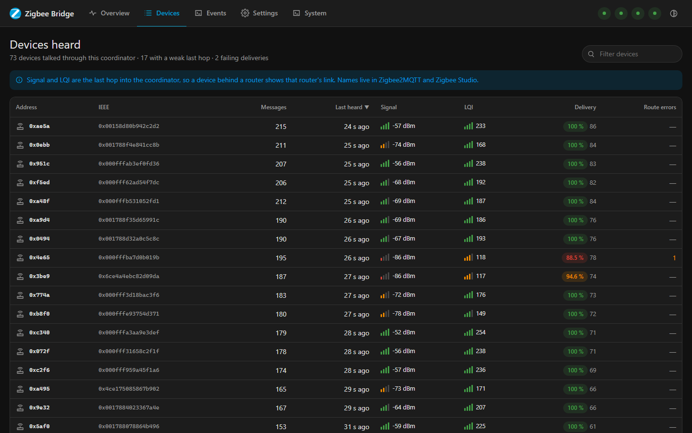

# Zigbee Bridge

**Put your Zigbee coordinator on the network, wherever reception is best.**

Your Zigbee USB stick usually has to sit right next to the Home Assistant box, often in a closet or
behind a rack: not a great place for a radio. Zigbee Bridge is firmware for a small Ethernet board
that the stick plugs into instead. Run one network cable (with power over it, if your switch does
PoE) to a central spot, and Zigbee2MQTT talks to the stick over the network as if it were still
plugged in.

It also keeps an eye on the link: a dashboard shows how Zigbee2MQTT and the stick are getting on,
which devices it hears and how well, and warns you about trouble.


## What it does

- **Bridges your stick to Zigbee2MQTT** over TCP, with nothing to install on the Home Assistant side.
- **Shows the link's health**: deliveries, response time, retries and errors, live and for the last
  24 hours.
- **Lists every device the coordinator hears**, with signal, link quality and delivery rate.
- **Updates itself** from this repository's releases, safely: a new version is checked before it's
  used, and the board goes back to the old one by itself if the new one doesn't start properly.
- **Flashes your stick's own firmware** from the dashboard: upload a file or pick a build it finds
  for your stick, and it checks the file before anything is written.
- **Keeps a log** that survives reboots (in flash, and on a microSD card if you add one).
- **Works with Zigbee Studio**, which shows the bridge's health next to your Zigbee network.

| Devices it hears | Settings |
| --- | --- |
|  |  |

## What you need

- A **Waveshare ESP32-P4-POE-ETH** board (with the PoE module if you want power over the cable)
- A short **MX1.25 4-pin to USB-A** adapter cable for the board's USB host port (J3)
- A Zigbee USB stick. Tested with the **SONOFF Dongle Plus MG24**; other Silicon Labs (EmberZNet)
  sticks work too, and TI, ConBee and nRF sticks are passed through as well.
- A USB-C cable for the first flash

## Getting started

1. **Flash the firmware** once over USB-C (later updates arrive over the network). Download
   `zigbee_eth_bridge-<version>-full.bin` from the [latest release](https://github.com/home-controls/zigbee-bridge/releases/latest)
   and write it with [esptool](https://docs.espressif.com/projects/esptool/):
   `esptool --chip esp32p4 write_flash 0x0 zigbee_eth_bridge-<version>-full.bin`.
   Or build it yourself with ESP-IDF 5.5, see [the technical reference](docs/TECHNICAL.md#build-and-flash).
2. **Plug the stick into J3** and connect the network cable.
3. **Open the dashboard** at `http://zigbee-eth-bridge.local` (or the address your router gave it)
   and **create a password**. There's no default password.
4. On **Settings**, give it a **fixed IP address** and, for safety, the address of the machine
   Zigbee2MQTT runs on.
5. **Point Zigbee2MQTT at it.** The dashboard shows the exact lines to copy, for example:

   ```yaml
   serial:
     port: tcp://192.168.1.50:6638
     adapter: ember
     baudrate: 115200
     rtscts: false
   ```

Restart Zigbee2MQTT, and your devices are back, now through the bridge.

## Questions

**What if the bridge reboots?** Zigbee2MQTT notices, waits a moment and reconnects by itself; a
reboot usually costs about ten to twenty seconds.

**I set a wrong IP address and can't reach it.** Power it on and off five times in a row, each time
for less than ten seconds. It forgets its settings and comes back on DHCP.

**Can anyone on my network connect to my stick?** Only until you set the allowed Zigbee2MQTT host
on the Settings page. After that the bridge refuses everyone else. The dashboard itself always needs
your password.

**Where are the details?** Hardware pins, the API, the update process, flashing sticks, the stored
log, watchdogs and tests are all in [the technical reference](docs/TECHNICAL.md).

## The Zigbee family

Zigbee Bridge is one of three apps that share one look:

| | |
| --- | --- |
| [Zigbee Studio](https://github.com/home-controls/zigbee-studio) | A fast page for Zigbee2MQTT; shows this bridge's health too |
| [Zigbee Sniffer](https://github.com/home-controls/zigbee-sniffer) | Listen to your network with small ESP32 radios |
| **Zigbee Bridge** | This one: your coordinator on Ethernet |

## License

MIT, see [LICENSE](LICENSE). Zigbee and the Zigbee logo are trademarks of the Connectivity Standards
Alliance; this project is not affiliated with or endorsed by it.
